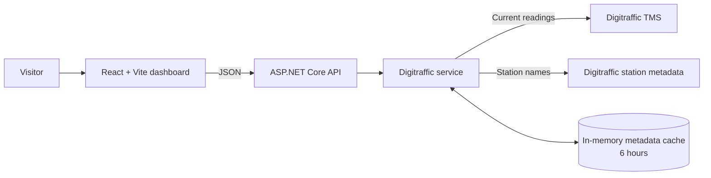

# Traffic Insight

Live Finnish road traffic dashboard built with React and ASP.NET Core. It reads current traffic measurements from Digitraffic, refreshes them every minute, and presents station readings and analytics in one place.

## Features

- Live station readings for vehicle volume and average speed
- Search by station name or station ID
- Summary cards and charts based on the latest reported values
- Clear handling for missing measurements; unavailable values are never shown as zero
- Station names from Digitraffic metadata, with station ID fallback
- Read-only design with no manual or generated measurements

## Architecture



The browser calls the app API. The API fetches live TMS readings and station metadata from Digitraffic, maps them into a compact response, and caches station metadata in memory for six hours. Current readings are fetched for each API request; the frontend refreshes every minute.

### Data storage

This application has **no database**. It does not save traffic history or user data. The only cache is temporary station metadata in the running API process. A persistent database such as PostgreSQL would make sense if the app later needs historical snapshots, accounts, saved preferences, or reports that must remain available when Digitraffic is unavailable.

## Technology

| Area | Technologies |
| --- | --- |
| Frontend | React, Vite, Recharts |
| Backend | ASP.NET Core Minimal API, .NET 10 |
| Live data | Digitraffic / Fintraffic TMS |
| Tests | xUnit backend service tests; frontend ESLint and production build checks |

## Run locally

### Requirements

- .NET 10 SDK
- Node.js 22.12 or later and npm

### 1. Start the API

From the repository root:

```sh
dotnet run --project backend/TrafficInsight.Api
```

The HTTP launch profile listens at `http://localhost:5278`. Available endpoints:

- `GET /health` — health status
- `GET /api/traffic/external` — current station measurements

Swagger is available only when the API runs in Development.

### 2. Configure and start the frontend

In a second terminal, create `frontend/.env` using the committed example:

```sh
cp frontend/.env.example frontend/.env
```

Then install dependencies and start Vite:

```sh
cd frontend
npm ci
npm run dev
```

Open the local Vite address shown in the terminal, normally `http://localhost:5173`.

## Data notes

The API maps Digitraffic's five-minute moving average speed to `averageSpeedKmh` and vehicle count data to `vehiclesPerHour`. Missing source values remain `null`; the UI shows “Not available” and excludes unavailable speed values from the speed chart. Station names may be unavailable, in which case the dashboard uses the station ID. Live availability and sensor coverage depend on Digitraffic.

See [Digitraffic road traffic documentation](https://www.digitraffic.fi/en/road-traffic/). Follow its current API usage instructions and attribution/license terms when redistributing the data.

## Tests and quality checks

Run backend tests from the repository root:

```sh
dotnet test backend/TrafficInsight.slnx
```

Run frontend checks from `frontend/`:

```sh
npm run lint
npm run build
npm audit
```

Check .NET dependencies for known vulnerabilities:

```sh
dotnet list backend/TrafficInsight.slnx package --vulnerable --include-transitive
```

The current backend unit tests cover service mapping, missing speed values, and metadata fallback. The project does not yet have API integration tests or browser end-to-end tests.

## Security and deployment notes

- The dashboard is public and read-only; it has no user accounts or private data.
- CORS uses configured origins. The local default allows Vite at `http://localhost:5173`; production must set `AllowedOrigins__0` to the exact deployed frontend origin.
- Swagger is disabled outside Development.
- The API calls Digitraffic over HTTPS and returns sanitized upstream errors.
- CORS is not API access control. Before a public launch, configure an upstream timeout, request rate limiting, monitoring, and HTTPS at the hosting platform.
- `VITE_*` values are included in browser assets. Never place passwords, private keys, or other secrets in them.
- The repository is not yet packaged for Docker or connected to a deployment pipeline.

## Repository layout

```text
backend/
  TrafficInsight.Api/          ASP.NET Core API and Digitraffic integration
  TrafficInsight.Api.Tests/    Backend unit tests
  TrafficInsight.slnx          .NET solution
frontend/
  src/                          React dashboard and chart components
  public/                       Static public assets
  .env.example                  Local API URL example
```
