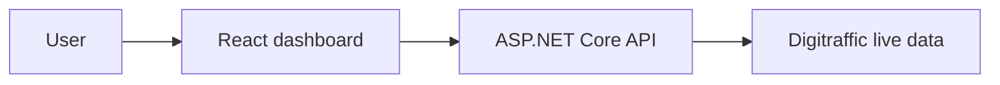

# Traffic Insight

Live dashboard for Finnish road traffic. It displays vehicle counts and reported average speeds from Digitraffic.

[**Open the live dashboard**](https://traffic-insight-dashboard.onrender.com) · [API health](https://traffic-insight-api.onrender.com/health) · [](https://github.com/ud4uddav/traffic-insight/actions/workflows/ci.yml)

## Features

- Live readings for available road stations, refreshed every minute
- Search by station name or ID
- Charts and summary cards for traffic volume and speed
- Missing readings display as “Not available,” never as zero
- Read-only app with no database or manually entered data

## Architecture



The API fetches current measurements and station names from Digitraffic. Station metadata is cached temporarily in memory; traffic history is not stored. The average speed shown is the arithmetic mean of stations reporting speed, not a traffic-volume-weighted average.

## Run locally

Requirements: Docker Desktop (or Docker Engine with Compose).

```sh
git clone https://github.com/ud4uddav/traffic-insight.git
cd traffic-insight
docker compose up --build
```

Open [http://localhost:8080](http://localhost:8080). Stop with `Ctrl+C`, then run `docker compose down`.

## Tests

```sh
dotnet test backend/TrafficInsight.slnx
cd frontend && npm ci && npm test && npm run lint && npm run build
```

GitHub Actions runs tests, dependency checks, and Docker builds on pushes and pull requests. Render deploys after the checks pass; the service configuration is in [`render.yaml`](render.yaml).

## Data and deployment notes

Live data is provided by [Digitraffic / Fintraffic](https://www.digitraffic.fi/en/road-traffic/). Sensor coverage and the availability of individual measurements depend on the source.

The dashboard and API are public and read-only. The API is rate-limited; CORS is restricted to the dashboard origin. No credentials or user data are required. Render’s free API service can sleep when idle, so its first request after inactivity may take longer to respond.
