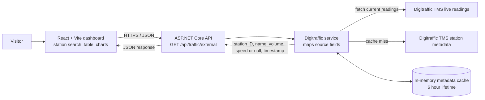

# Traffic Insight

Traffic Insight is a live Finnish road traffic dashboard. A React/Vite frontend calls a small ASP.NET Core API, which reads current traffic measurements and station metadata from Digitraffic. The dashboard refreshes automatically every minute and can also be refreshed on demand. It does not store or generate traffic measurements.

## System architecture



The browser talks only to this app's API. The API fetches current TMS readings from Digitraffic, looks up station names from its metadata endpoint, and returns a smaller response shaped for the dashboard. Station metadata is cached in memory for six hours; current readings are requested each time the API route is called. The frontend refreshes that route every minute.

### Do we need PostgreSQL?

No, not for the current feature set. This app displays public, current readings and does not accept or retain user-entered data. Digitraffic is the source of truth, while the only cache is temporary station metadata in the API process. PostgreSQL would add setup and operations without helping this read-only flow.

Add a database later if the product needs to keep its own information, such as historical snapshots, saved stations, user accounts or preferences, annotations, or reports that must remain available when Digitraffic is down. PostgreSQL would be a suitable choice for that persistent application data; it should complement the live feed rather than replace Digitraffic as the source of current readings.

## Requirements

- .NET 10 SDK
- Node.js 22.12+ and npm

## Run locally

1. Start the API from the repository root:

   ```sh
   dotnet run --project backend/TrafficInsight.Api
   ```

   The HTTP launch profile uses `http://localhost:5278`. The API provides `/health` and `/api/traffic/external`; Swagger is enabled in Development.

2. In another terminal, set `frontend/.env`:

   ```dotenv
   VITE_API_URL=http://localhost:5278/api/traffic
   ```

   The repository includes `frontend/.env.example` with this local value.

3. Install and run the frontend:

   ```sh
   cd frontend
   npm ci
   npm run dev
   ```

   Open the Vite URL, normally `http://localhost:5173`.

## Data behavior

The API reads current TMS station data and station names from Digitraffic. It returns the moving 5 minute average speed as `averageSpeedKmh`, hourly vehicle volume as `vehiclesPerHour`, station names when available, and measurement timestamps. Missing readings remain null and appear as “Not available”; unavailable speed values are excluded from the speed chart. Station metadata is cached in memory for six hours. Live values depend on source availability and sensor coverage.

Digitraffic road data documentation: <https://www.digitraffic.fi/en/road-traffic/>. Attribute Digitraffic/Fintraffic when redistributing the open data and review its current license and API usage instructions before release.

## Deployment preparation

Build the frontend with the production API URL set as `VITE_API_URL`; Vite embeds this value at build time, so a changed API URL requires a new frontend build. Configure the backend with:

- `AllowedOrigins__0`: the exact deployed frontend origin, such as `https://traffic.example.com`.
- `ASPNETCORE_ENVIRONMENT=Production`.

Serve both frontend and API over HTTPS. Keep Swagger restricted to development unless the deployment adds an access policy. No cloud provider or paid service is assumed.

## Security

Current protections and design choices:

- The frontend contains only the public API URL. Do not put passwords, private API keys, or other secrets in `VITE_*` variables; Vite embeds them into browser files.
- The backend calls Digitraffic over HTTPS, so the browser does not need to contact the data provider directly.
- CORS allows configured frontend origins instead of `*`. Set `AllowedOrigins__0` to the exact deployed site origin.
- Swagger is enabled only in Development, and upstream HTTP or JSON errors are returned without exposing exception details.
- The dashboard is read-only and has no user accounts or private data, so it currently has no authentication.

Limits to understand before a public launch:

- CORS is a browser rule, not API access control. Anyone who can reach the API can call its public read endpoint directly.
- The API does not yet configure rate limiting, an explicit upstream request timeout, or authentication. For a public deployment, add rate limits and monitoring to protect the API and Digitraffic from excessive traffic; configure a bounded upstream timeout. Add authentication only if private or user-specific features are introduced.
- Enforce HTTPS at the host or reverse proxy, keep dependencies patched, and store deployment configuration in the hosting platform rather than committing secrets.

## Testing and checks

The current backend test suite has two unit tests for `DigitrafficService`: station and speed mapping, and preservation of unavailable speed as null. It does not currently include API endpoint integration tests or browser end-to-end tests. The frontend has lint and production-build checks but no component test runner yet.

Run the current checks:

- From `frontend/`: `npm run lint`, `npm run build`, and `npm audit`.
- From the repository root: `dotnet test backend/TrafficInsight.slnx`.
- Check .NET dependencies with `dotnet list backend/TrafficInsight.slnx package --vulnerable --include-transitive`.

For stronger release confidence, add tests for the API's success and upstream-failure responses, frontend rendering/search/null-speed states, and an end-to-end run against a controlled test response. Tests should not depend on live Digitraffic availability.
